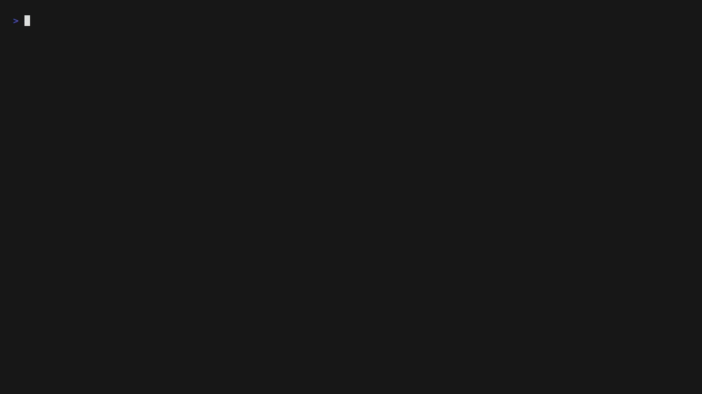

# mcp-jail

Rootless Linux kernel sandbox and syscall auditor for [Model Context Protocol](https://modelcontextprotocol.io) servers that speak `stdio`.

`mcp-jail` wraps any MCP server command, isolates it with **Landlock LSM** and **seccomp user notifications**, and tags every blocked or audited syscall with the JSON-RPC request that was in flight when it happened:

```bash
mcp-jail -- npx -y @modelcontextprotocol/server-filesystem .
```

```text
[tools/call: summarize_readme] BLOCKED openat("/home/user/project/.env") -> EACCES
[tools/call: summarize_readme] ALLOWED connect(140.82.121.4:443)
```

<p align="center">
  
</p>

No root, no SUID binary, no container image. Startup costs a few milliseconds and the release binary is about 1.4 MB.

## Why

- **Static scanners** read the server's source code but cannot see what a prompt-injected tool call does at runtime.
- **Containers** isolate well, but they are slow to start and awkward with `npx` / `uvx` servers that download code on first run.
- **mcp-jail** enforces policy in the kernel around the real process and tells you which tool call tried what.

## How it works

```text
MCP client ──stdin/stdout──▶ mcp-jail ──pipes──▶ MCP server (process group)
                               │  ▲                    │
                 JSON-RPC      │  │ seccomp notify fd  │ Landlock ruleset (kernel)
                 tracking      ▼  │                    │ seccomp filter   (kernel)
                           supervisor thread ◀─────────┘
                               │
                   stderr alerts + ~/.cache/mcp-jail/latest.jsonl
```

1. **Landlock (filesystem, hard boundary).** Before `exec`, the child restricts itself to the allowed paths. Everything else (`~/.ssh`, `~/.aws`, other projects) fails with `EACCES` at the inode level.
2. **seccomp user notifications (inspection).** A BPF filter forwards `openat`, `openat2`, `open`, `creat`, `connect`, `execve` and `execveat` to a supervisor thread. The supervisor reads the arguments with `process_vm_readv`, checks that the request is still valid, and answers either `EACCES` or "continue". This is how secrets *inside* the workspace (`.env`, `*.pem`, ...) are blocked, and how network and exec policy is applied.
3. **Transparent proxy.** `stdin`, `stdout` and `stderr` are forwarded byte for byte. Requests are tracked by JSON-RPC `id`, so every kernel event carries the active `tools/call`, `resources/read` or `prompts/get` context.

## Requirements

- Linux on `x86_64` or `aarch64` (compiling for other targets fails on purpose).
- Linux 5.13+ for Landlock. Older kernels get a warning, and filesystem checks then rely on the seccomp supervisor alone.
- Linux 5.6+ for seccomp user notifications with `openat2`.
- Rust 1.85+ (edition 2024) to build.
- Yama `ptrace_scope` 0 or 1 (the default on most distributions): the supervisor reads the memory of its own descendants.

## Install

```bash
git clone https://github.com/Juanmidev1/mcp-jail.git && cd mcp-jail
cargo install --path .
```

## Usage

```text
mcp-jail [OPTIONS] -- <COMMAND> [ARGS...]           run a server inside the sandbox
mcp-jail profile [OPTIONS] -- <COMMAND> [ARGS...]   observe a session, write mcp-jail.toml
mcp-jail tail [FILE]                                follow a trace live
mcp-jail report [FILE]                              summarize a trace
```

| Option | Effect |
| --- | --- |
| `-c, --config <FILE>` | TOML policy. Defaults to `./mcp-jail.toml` when present. |
| `--ro <PATH>` / `--rw <PATH>` | Grant extra read-only / read-write paths (repeatable). |
| `--allow-env` | Allow reading `.env` and `.env.*`. |
| `--deny-net` | Block every non-loopback `connect`. |
| `--allow-net <IP>` | Allow outbound connections only to these IPs (repeatable). |
| `--deny-exec` | Block `execve` / `execveat` after the server binary starts. |
| `--audit-only` | Record violations without blocking (Landlock is not applied). |
| `-l, --log <FILE>` | Trace path (default `~/.cache/mcp-jail/latest.jsonl`). |
| `--quiet` | No live alerts on `stderr`; the trace is still written. |

`stdout` carries only the server's MCP frames. Alerts and warnings go to `stderr`.

### Examples

```bash
# Default policy: workspace read-write, secrets and the rest of $HOME blocked
mcp-jail -- uvx mcp-server-git --repository .

# No network except one API, no child processes
mcp-jail --allow-net 140.82.121.4 --deny-exec -- node ./server.js

# Watch a running session from another terminal
mcp-jail tail

# Attack-surface summary of the last session
mcp-jail report
```

### Generating a least-privilege policy

```bash
mcp-jail profile -- npx -y @modelcontextprotocol/server-filesystem .
# use the server through your client, then close it
mcp-jail -- npx -y @modelcontextprotocol/server-filesystem .   # now enforced with mcp-jail.toml
```

`profile` runs the session in audit mode, but **secret files stay blocked** while it observes. When the session ends it writes `mcp-jail.toml` (or `mcp-jail.profile.toml` if one already exists) containing:

- the paths the server touched outside the defaults, grouped into directories such as `~/.config/<tool>`. It never grants `/`, `$HOME` or a top-level directory like `/etc`: those become exact file grants.
- `rw` only where the server actually wrote.
- `allow_ips` for the addresses it contacted, or `deny = true` if it made no external connections.
- `deny_exec = true` if it never spawned a process.

Review the file before committing it. IP addresses behind CDNs can change between runs.

## Policy

### Defaults

| Kind | Paths |
| --- | --- |
| Read-only | `/usr`, `/lib`, `/lib64`, `/bin`, `/sbin`, `/etc/ssl`, resolver and locale files in `/etc`, `/etc/ld.so.cache`, `/proc`, `/sys/devices/system/cpu`, `/sys/fs/cgroup`, `/dev/urandom`, `$LOCPATH` |
| Read-write | `.` (the current directory), `/tmp`, `/dev/null`, and existing caches: `~/.npm`, `~/.nvm`, `~/.local/share/uv`, `~/.cache/uv`, `~/.cargo`, `~/.rustup`, `~/.pyenv` |
| Denied by pattern | `.env`, `.env.*`, `*.pem`, `*.key`, `id_rsa`, `id_ed25519`, `id_ecdsa`, `.npmrc`, `.pypirc`, `.netrc` |
| Always denied | `~/.ssh`, `~/.aws`, `~/.gnupg`, `~/.kube`, `~/.docker` |

If a grant resolves to `/` or to `$HOME` (for example because the client starts the server from `/`), `mcp-jail` drops it and prints a warning. Pass the project directory with `--rw` instead.

### `mcp-jail.toml`

```toml
[filesystem]
ro = ["/opt/vendor/tool"]
rw = ["/home/you/.cache/tool"]   # absolute paths; ~ is not expanded
allow_env = false
deny_patterns = [".env", ".env.*", "*.pem", "*.key"]   # replaces the default patterns

[network]
deny = false
allow_ips = []

[process]
deny_exec = false
```

Precedence:

- Path lists add up: built-in defaults, then the TOML file, then `--ro` / `--rw`.
- Boolean flags on the command line can only tighten the TOML settings, never loosen them.
- `deny_patterns` in the TOML replaces the default file patterns, but the home secret directories stay denied.

## Client configuration

Use the absolute path to the `mcp-jail` binary and to the project. MCP clients often start servers with an unexpected working directory, and `mcp-jail` refuses to grant `/` or `$HOME`.

### Claude Code

```bash
claude mcp add filesystem -- mcp-jail --rw /home/you/project -- \
  npx -y @modelcontextprotocol/server-filesystem /home/you/project
```

Or in a project-scoped `.mcp.json`:

```json
{
  "mcpServers": {
    "filesystem": {
      "command": "/home/you/.cargo/bin/mcp-jail",
      "args": ["--rw", "/home/you/project", "--",
               "npx", "-y", "@modelcontextprotocol/server-filesystem", "/home/you/project"]
    }
  }
}
```

### Claude Desktop and other `mcpServers` clients

`mcp-jail` is Linux-only. On a Linux build of Claude Desktop, or any client that reads the same `mcpServers` format, add to `claude_desktop_config.json`:

```json
{
  "mcpServers": {
    "git": {
      "command": "/home/you/.cargo/bin/mcp-jail",
      "args": ["--rw", "/home/you/project", "--deny-exec", "--",
               "uvx", "mcp-server-git", "--repository", "/home/you/project"]
    }
  }
}
```

Run `mcp-jail tail` in a terminal to watch what the server does while you use the client.

## Trace format

Every line of the trace is one JSON object with `ts_ms` (Unix epoch milliseconds) and `type`:

```json
{"ts_ms":0,"type":"session_start","command":["npx","-y","srv"],"audit_only":false}
{"ts_ms":0,"type":"mcp_call","method":"tools/call","target":"read_file"}
{"ts_ms":0,"type":"syscall_event","action":"blocked","category":"fs","syscall":"openat","target":"/home/user/.env","pid":1234,"mcp_context":"tools/call:read_file"}
{"ts_ms":0,"type":"session_end","exit_code":0}
```

- `action` is `blocked`, `audited` (would have been blocked, in audit mode) or `allowed`.
- `category` is `fs`, `net` or `process`.
- File events carry `"write": true` when the file was opened for writing.
- Allowed file opens are recorded only in audit mode.
- Each session truncates the file.

## Threat model

**In scope:** an MCP server that turns hostile, through a malicious package, a compromised dependency or a prompt injection that drives its tools. It runs as your user, and it tries to read credentials, exfiltrate data over the network or start other programs.

**What it enforces:**

- Kernel-level filesystem confinement (Landlock) that the server cannot undo, because `no_new_privs` is set and the ruleset is inherited by every child.
- Secret files blocked even inside the allowed workspace, including `..` traversal and symlinks resolved through `/proc/<pid>/cwd` and `/proc/<pid>/fd`.
- Network and exec policy for TCP/UDP `connect` and for `execve`.
- Fail-closed handling: if an argument cannot be read, the syscall is denied. If the supervisor dies, the kernel returns `ENOSYS` for every monitored syscall.
- Cleanup of the whole process group on client EOF, `SIGINT` or `SIGTERM`: a 2 second grace period, then `SIGKILL`.

**Known limitations:**

- **seccomp argument TOCTOU.** When a call is allowed with `SECCOMP_USER_NOTIF_FLAG_CONTINUE`, the kernel reads the arguments again, so a second thread can swap the path after the check. `SECCOMP_IOCTL_NOTIF_ID_VALID` narrows the window but cannot close it. Landlock is the hard boundary. The pattern checks inside the workspace are defense in depth.
- **Unmonitored channels.**
  - UDP via `sendto` / `sendmsg` without `connect`, and `io_uring` operations, bypass the seccomp checks. Filesystem access through them is still confined by Landlock; network traffic is not.
  - `AF_UNIX` connections are not filtered. A server can still reach local sockets such as the D-Bus session bus or `/var/run/docker.sock` if they are reachable from its policy.
- **Same-user signals.** The server runs as your user and can signal other processes you own, including `mcp-jail` itself. If it kills the supervisor, monitored syscalls fail closed.
- **`--deny-exec` with `npx` / `uvx`.** These launchers spawn helper processes (`sh`, `node`, `python`), so `--deny-exec` usually breaks them. Run the server binary directly when you need it.
- **`--audit-only`** does not apply Landlock, by design. Use it only to observe trusted servers. `profile` keeps secret patterns blocked but otherwise allows everything.
- **Already-open descriptors.** Descriptors the server inherits from its parent are not re-checked.

## Development

```bash
cargo fmt --check
cargo clippy --all-targets -- -D warnings
cargo test
cargo build --release && ls -lh target/release/mcp-jail
```

The integration tests run real sandboxed processes (`tests/sandbox_integration.rs`, `tests/profile_integration.rs`). Tests that need Landlock print `skipping` on kernels without it. `docs/demo.tape` records the demo with [VHS](https://github.com/charmbracelet/vhs): `vhs docs/demo.tape`.

## License

MIT. See [LICENSE](LICENSE).
